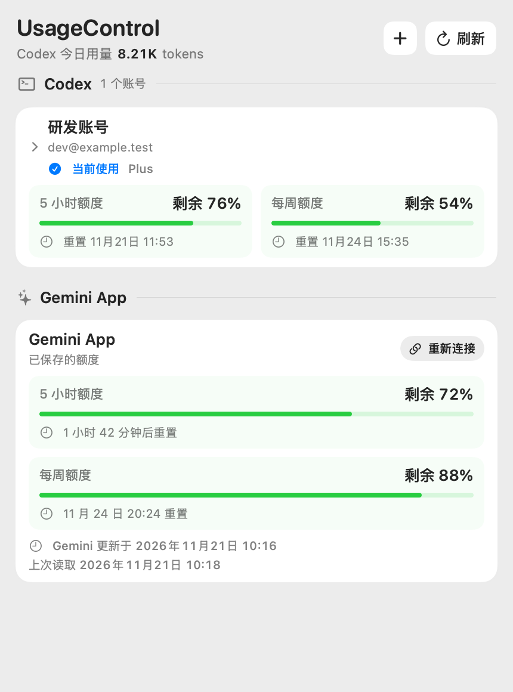

<picture>
  <source media="(prefers-color-scheme: dark)" srcset="https://raw.githubusercontent.com/ZeusLiu666/codexcontrol/v1.4.1-zeusliu.1/docs/images/CodexControl-1.4.1-macOS-dark.png">
  
</picture>

## English

**macOS · Apple Silicon · macOS 14 or later**

- Read Codex and Gemini App allowances from the same menu-bar panel. The five-hour and weekly cards show remaining quota and reset times. Gemini marks saved readings when live updates pause. Choose the plus menu to connect the Gemini Mac app and allow Accessibility access in System Settings.
- Expand an account from its header, refresh with ⌘R, or cancel account removal with Esc. Manual Gemini refresh now stays busy until it finishes. Traditional Chinese usage panels display reset times and report load errors.
- A timed-out or cancelled Codex sign-in now stops the login process. Large command output no longer stalls the account setup window.
- If account removal fails, the account stays visible and its saved credentials are retained.
- Open the **DMG** and drag CodexControl to Applications, or use the **PKG** installer. Quit the running copy first. Both install build 23 with the menu-bar app and widget. The app is ad-hoc signed and has no Apple notarization.

**Windows · x64 · Windows 10 version 1809 or later and Windows 11**

- Search shows the number of matching accounts. Press Esc to clear the query and keep typing. A wider scrollbar hit target and corrected thumb position make long lists easier to navigate.
- The dashboard shows separate intervals for quota refresh and Token scanning. Returning to local tracking now clears the previous remote tooltip.
- Choose **Setup.exe** for a per-user install or extract the **portable.zip** and run CodexControl.exe. Both use the existing account data in the current user’s profile. The Windows executables are unsigned.

Each platform has a SHA-256 checksum file. The tagged builds run the macOS Swift suite, Gemini quota parser checks, and Windows regression suite with synthetic data. Real account sign-in and live provider quotas require your own accounts.

Based on [Adem Isler’s CodexControl](https://github.com/ademisler/codexcontrol), distributed under the MIT License.

## 简体中文

**macOS · Apple Silicon · macOS 14 及以上**

- 从同一个菜单栏面板查看 Codex 和 Gemini App 的额度。卡片分别显示五小时和每周的剩余百分比、重置时间。Gemini 暂停实时更新时会标明上次保存的读数。使用加号菜单连接 Gemini Mac 客户端，在系统设置中授予辅助功能权限。
- 点击账号标题或用键盘展开详情，按 ⌘R 刷新，按 Esc 取消移除账号。手动刷新 Gemini 的进度指示会保留到操作完成。繁体中文用量面板可正确显示重置时间和加载失败提示。
- 登录超时或取消时会终止对应进程，修复登录命令产生大量输出时添加账号界面一直等待的问题。
- 移除账号失败时保留列表中的账号及其已保存的凭据。
- 退出旧版后，可打开 **DMG** 将应用拖入「应用程序」，也可运行 **PKG**。两种方式均安装构建 23，含菜单栏应用和桌面小组件。应用采用 ad-hoc 签名，未经 Apple 公证。

**Windows · x64 · Windows 10 1809 及以上、Windows 11**

- 搜索时可看到匹配账号数，按 Esc 清空后可继续输入。滚动条的可点击区域更宽，修复长列表拖动时滑块与指针位置错位的问题。
- 面板分别显示额度刷新和 Token 扫描周期。切回本地统计后，悬停提示会同步清除上一次的远程状态。
- **Setup.exe** 按当前用户安装，也可以解压 **portable.zip** 后运行 CodexControl.exe。两种方式均使用当前用户已有的账号目录。Windows 程序未签名。

每个平台都有独立的 SHA-256 校验文件。标签构建运行 macOS Swift 回归、Gemini 额度解析检查和 Windows 回归测试，使用合成数据。真实账号登录与在线额度需要使用者自己的账户。

本项目基于 [Adem Isler 的 CodexControl](https://github.com/ademisler/codexcontrol) 改进，遵循 MIT 许可证。
